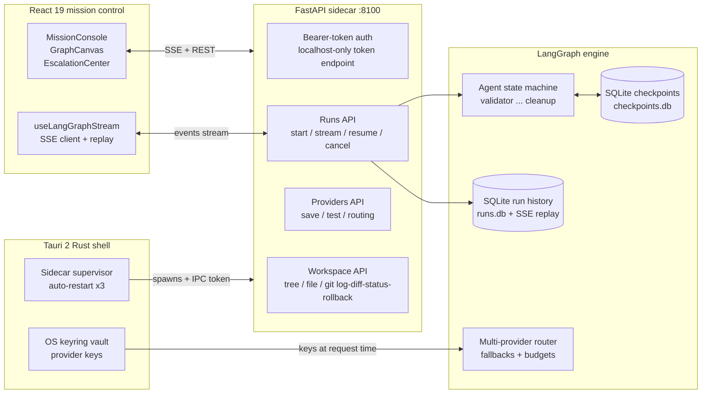
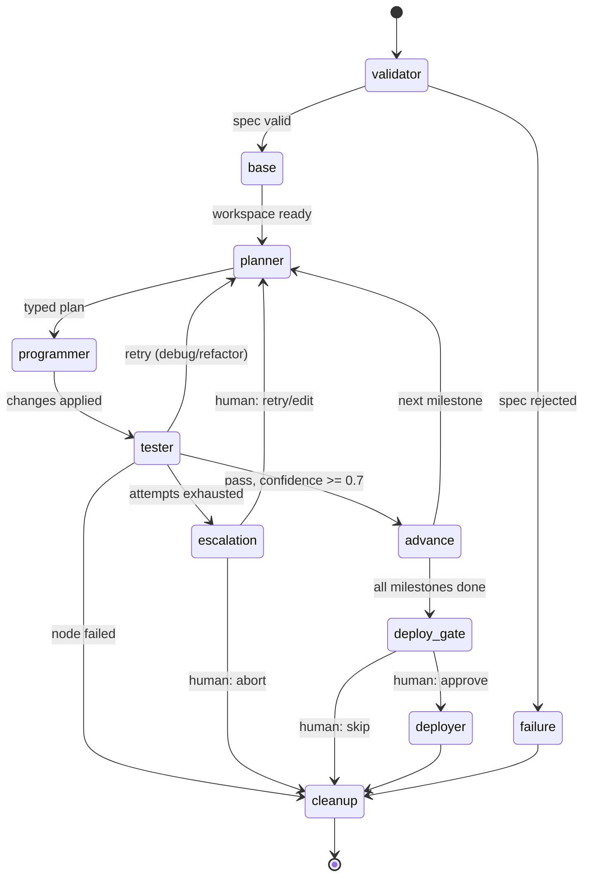

# symbiot

**The Autonomous Multi-Agent Software Engineering Platform — with a native desktop Mission Control.**

Drop in a `PROJECT.md` specification. Symbiot plans each milestone, writes the
code, runs the tests, judges the result, heals its own failures, and streams
every step live to a Tauri 2 mission-control center — with a human in the loop
exactly where it matters.

[](https://github.com/Abol1644/symbiot/actions/workflows/ci.yml)


> **Localhost only.** Symbiot binds `127.0.0.1`, mints a per-launch API token,
> and SSRF-gates every outbound provider call. Never expose the sidecar to a
> public network without an authentication proxy.

---

## Why Symbiot?

Most "AI coders" are autocomplete with confidence. Symbiot is a **deterministic
LangGraph state machine** that treats software delivery as a verifiable
pipeline:

1. **Specify** — a structured `PROJECT.md` declares milestones, acceptance
   criteria, and budgets.
2. **Plan** — an LLM planner drafts typed `create/edit/run/delete` steps per
   milestone (`backend/src/symbiot/nodes/planner.py`).
3. **Build** — the programmer executes the plan natively with path containment
   and command guards (`nodes/programmer.py`).
4. **Verify** — the tester runs pytest, compiles every file, then an LLM judge
   scores acceptance criteria with a confidence value (`nodes/tester.py`).
5. **Heal or escalate** — low-confidence or failing milestones loop back as
   debug/refactor plans; exhausted retries surface a human decision gate with
   full diff + failure evidence (`graph.py`, `router.py`).
6. **Watch it live** — every node streams structured events over SSE into a
   React Flow mission-control UI, backed by SQLite run history you can replay
   after a restart (`run_manager.py`, `useLangGraphStream.ts`).

---

## System architecture



## Autonomous agent loop



---

## Feature matrix

| Pillar | Capability | Where it lives |
|---|---|---|
| **Autonomous orchestration** | `PROJECT.md` spec validation with milestone/budget parsing | `backend/src/symbiot/nodes/validator.py` |
| | Iterative per-milestone planning (`build`/`debug`/`refactor`) with lessons + human guidance in context | `nodes/planner.py`, `prompts/planner.md` |
| | Plan execution: create/edit (LLM-assisted), run commands, delete — all path-contained | `nodes/programmer.py` |
| | Verification: pytest run + `py_compile` sweep + LLM judge emitting `TestReport(passed, confidence, artifacts)` | `nodes/tester.py`, `schemas.py` |
| | Self-healing retry loop; `escalation` human gate with redacted diff + failures; `deploy_gate` approval | `graph.py`, `nodes/router.py` |
| **Mission control UI** | Live React Flow agent graph, pipeline rail, agent activity + terminal panels | `frontend/src/components/GraphCanvas.tsx`, `PipelineRail.tsx`, `AgentActivity.tsx`, `TerminalPanel.tsx` |
| | Real-time SSE event stream, replayable history, command palette, run reruns | `hooks/useLangGraphStream.ts`, `CommandPalette.tsx`, `HistoryView.tsx` |
| | Workspace file tree, file viewer, git log/diff/status/rollback inspector | `FileTree.tsx`, `StateInspector.tsx`, `api/sidecar.ts` |
| | Provider management, run profiles, escalation inbox | `ProvidersView.tsx`, `ProfileView.tsx`, `EscalationCenter.tsx` |
| **Multi-provider intelligence** | OpenAI, Anthropic, OpenRouter, OpenCode AI, generic OpenAI-compatible (Ollama/vLLM local) | `backend/src/symbiot/providers.py` |
| | Per-node model routing with automatic fallback chains + retry/backoff | `providers.py` (`ProviderRouter`), `llm.py` |
| | Structured-JSON invocation with schema validation; retries counted against budgets | `llm.py`, `guards.py` (`BudgetLedger`) |
| | Keys from env or OS keyring vault; never persisted in run state or logs | `vault.py`, `provider_store.py`, `redaction.py` |
| **Safety & durability** | SQLite checkpoints (resume after crash) + run/event history with 30-day retention | `run_manager.py` |
| | Token / LLM-call / cost caps + 30-minute-max run timeout, enforced per node | `guards.py`, `schemas.py` (`Budget`) |
| | Workspace path containment, command allowlist, SSRF-gated provider URLs | `nodes/programmer.py`, `providers.py` |
| | Automatic secret redaction in prompts, events, errors, and stored previews | `redaction.py`, `providers.py` |
| | Token-authenticated sidecar, localhost-only token endpoint, CORS locked to dev origin + Tauri | `sidecar.py` |

---

## Quickstart

### Prerequisites

- Python 3.12+ with [`uv`](https://docs.astral.sh/uv/) installed
- Node.js 22+ with [`pnpm`](https://pnpm.io/) installed
- Rust toolchain + Tauri system deps — desktop builds only (see `docs/DEPLOYMENT.md`)
- Git (workspace repos are git-tracked per milestone)

### 1. Backend sidecar

```bash
cd backend
uv sync
cp .env.example .env   # set MODEL_PROVIDER / MODEL_NAME / API key
uv run uvicorn symbiot.sidecar:app --app-dir src --host 127.0.0.1 --port 8100
```

### 2. Web mission control

```bash
cd frontend
pnpm install --frozen-lockfile
pnpm dev        # http://localhost:5173 — paste a PROJECT.md, hit Launch mission
```

### 3. Desktop app (Tauri 2)

```bash
cd frontend
pnpm install --frozen-lockfile
pnpm tauri:dev  # supervises the sidecar, vault via OS keyring
```

### 4. CLI loop (checkpointed, resumable)

```bash
cd backend
uv run python run_loop.py
```

### 5. Test suite

```bash
# Backend (69 tests + durability/security suites)
uv run --project backend pytest backend/tests -m "not real_provider"
uv run --project backend ruff check backend/src backend/tests

# Frontend
cd frontend && pnpm tsc -b && pnpm lint && pnpm test --run && pnpm build
```

> Live-provider smoke test (opt-in, costs a few cents):
> `SYMBIOT_REAL_PROVIDER_TEST=1 SYMBIOT_TEST_API_KEY=sk-... uv run --project backend pytest backend/tests/test_real_provider.py -v -s`

---

## The `PROJECT.md` contract

```markdown
## META
name: my-project | stack: python 3.12 | runtime: cli | entrypoint: main.py | smoke_command: --help

## OBJECTIVE
One-line description of what this project does.

## END_CRITERIA
- Criterion 1
- Criterion 2

## MILESTONES
- {id: m1, title: first feature, acceptance_criteria: ["criterion 1"], max_attempts: 3}
- {id: m2, title: second feature, acceptance_criteria: ["criterion 2"], max_attempts: 3}

## BUDGET
token_cap: 500000
llm_call_cap: 50

## OUT_OF_SCOPE
no database, no web UI
```

`validator.py` enforces every section; `router.py` advances a milestone only on
`passed + confidence ≥ 0.7`, otherwise the loop self-heals or asks you.

---

## Project structure

```
symbiot/
├── AGENTS.md                  # contributor context for coding agents
├── backend/
│   ├── src/symbiot/
│   │   ├── graph.py           # LangGraph state machine + human gates
│   │   ├── nodes/             # validator, base, planner, programmer,
│   │   │                      # tester, router, deployer
│   │   ├── run_manager.py     # SQLite runs/events, checkpoints, SSE, retention
│   │   ├── sidecar.py         # token-auth FastAPI: runs, providers, workspace
│   │   ├── providers.py llm.py# multi-provider router + structured invocation
│   │   ├── guards.py          # budget ledger, run timeout
│   │   ├── schemas.py state.py# Plan, TestReport, Budget, LoopState
│   │   ├── git_ops.py         # workspace git: init, commit, log, rollback
│   │   ├── vault.py provider_store.py  # OS-keyring keys, provider config
│   │   └── redaction.py config.py      # secret redaction, settings
│   ├── tests/                 # graph smoke, providers, durability, security gate…
│   └── run_loop.py            # checkpointed CLI runner
├── frontend/
│   ├── src/                   # MissionConsole, GraphCanvas, EscalationCenter,
│   │                          # Providers/History/Profile views, SSE hook, API clients
│   └── src-tauri/             # Tauri 2 shell: sidecar supervision, keyring vault
├── projects/example/          # sample PROJECT.md
└── docs/DEPLOYMENT.md         # packaging, env reference, security posture
```

## Safety model

- **Native execution** — agent commands run on the host via `subprocess`
  (30 s cap); file writes are contained to the milestone workspace and every
  target is validated against traversal escapes.
- **Budget governor** — hard caps on tokens, LLM calls, and optional cost;
  every provider attempt is reserved before it runs and recorded per provider.
- **Human gates** — `escalation` on exhausted retries, `deploy_gate` after all
  milestones pass; both ride LangGraph `interrupt()`.
- **Secrets** — API keys live in env or the OS keyring, are masked in every
  API response, and are redacted out of prompts, events, errors, and history.
- **Network** — provider URLs are SSRF-validated (metadata/private ranges
  blocked); the sidecar only trusts localhost and the Tauri webview origin.

See `docs/DEPLOYMENT.md` for packaging, the full environment-variable
reference, retention policy, and production guidance.
